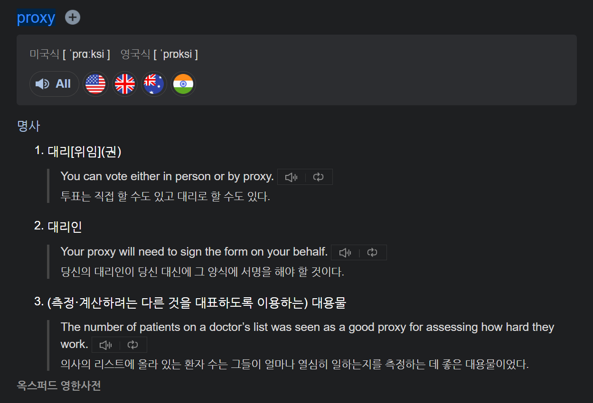
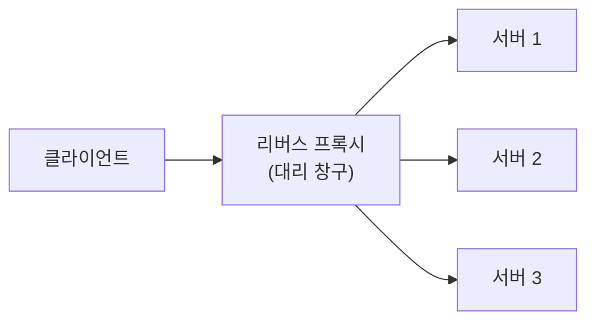

 
## 프록시의 본질
 
**프록시(Proxy) = 대리인**
 
 
  

그렇다면 **무엇을** 대리하는가?

| 구분 | 대리하는 대상 |
|---|---|
| 포워드 프록시 | 클라이언트 |
| 리버스 프록시 | 서버 |
 
**리버스 프록시 = 서버 앞에 서서, 서버로 오는 요청을 대신 받아 백엔드로 넘겨주는 대리 창구**
 

 
**모든 요청이 반드시 이 창구를 지나가기 때문에**
로드 밸런싱, 경로별 라우팅, 캐싱, 장애 처리, 보안, 로그 수집
→ 모두 이 **대리 창구**라는 본질에서 자연스럽게 딸려 나오는 기능
 
---
 
## 왜 필요한가
 
서버가 클라이언트의 요청을 바로 받으면 되지 않을까?
→ 받을 수는 있지만, **감당하지 못하는 순간**이 생김
 
예: **블랙 프라이데이 자정**, 세일 시작과 함께 요청이 한꺼번에 몰림
 
| 창구가 없으면 | 창구가 해결하는 방법 |
|---|---|
| 클라이언트가 서버 주소 하나만 알고 있어서 **한 서버에 요청이 몰림** | **로드 밸런싱·라우팅**: 요청을 여러 서버에 나눠 보내고, 경로에 따라 알맞은 서버 그룹으로 보냄 |
| 결과가 같은 요청(인기 상품 조회 등)도 **매번 서버가 처리함** | **캐싱**: 한 번 받은 응답을 창구가 기억해 두었다가, 같은 요청에는 서버까지 가지 않고 바로 돌려줌 |
| 서버 하나가 멈추면 그 서버로 간 사용자는 **그대로 에러**를 받음 | **장애 처리**: 응답이 없으면 다른 서버로 다시 보내고, 멈춘 서버는 빼 둠 |
| 서버가 외부에 그대로 드러나 **보안에 취약해짐** | **서버 숨김**: 외부에는 창구만 보이고, 서버는 안쪽에 둠 |
 
---
