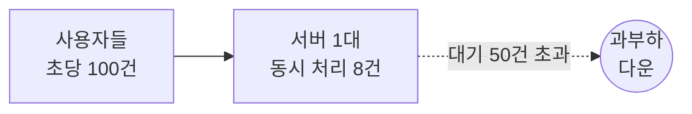
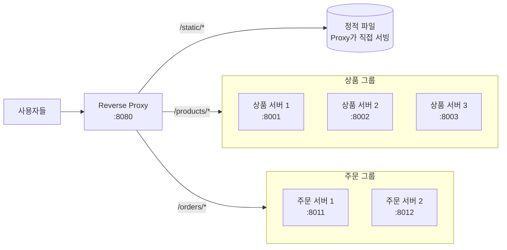
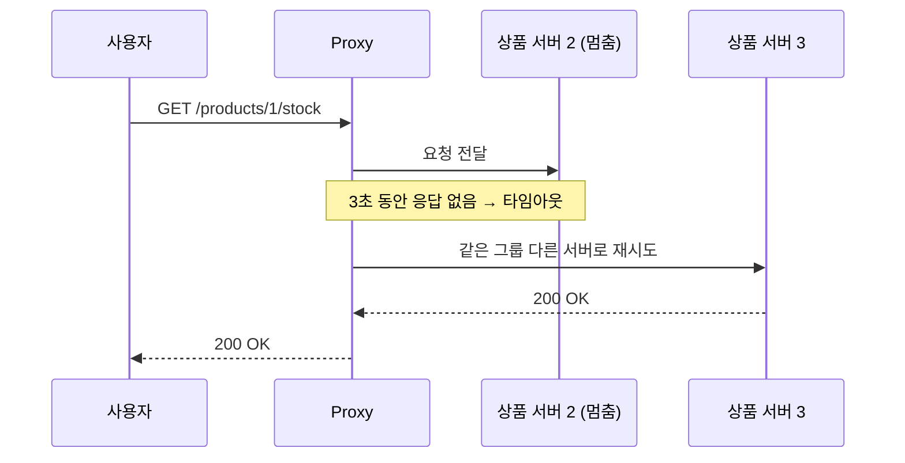

# 블랙 프라이데이를 버티는 Reverse Proxy

> C와 POSIX 소켓 API만으로 tiny-server를 확장해 만든 **Reverse Proxy**입니다.
> 경로 기반 라우팅, 그룹별 Round-Robin 로드 밸런싱, 캐싱, 장애 처리(타임아웃·재시도·헬스 체크)를 구현했습니다.

**데모 페이지:** 실행 후 브라우저에서 `http://localhost:8080/static/demo.html`

---

## 1. 문제: 서버 1대로는 세일을 버틸 수 없다

블랙 프라이데이 자정, 세일이 시작되면 요청이 한꺼번에 몰립니다.
서버가 1대뿐이면 모든 요청이 그 서버에 쌓이고, 처리 한계를 넘는 순간 서버가 무너집니다.



| 항목 | 값 |
|---|---|
| 서버 1대의 처리 한계 | 동시 8건, 요청당 300ms → 초당 약 27건 |
| 세일 트래픽 | 초당 최대 100건 |
| 결과 | 대기열이 쌓이며 응답이 점점 느려지다가, 대기 50건을 넘으면 과부하로 다운 |

> **데모 장면 0** · Proxy를 끄고 트래픽을 천천히 올립니다. 서버 1의 대기열이 쌓이다가 무너집니다.

---

## 2. 해결: Reverse Proxy

**Reverse Proxy는 서버 앞에 서서, 서버를 대신해 요청을 받는 중간 서버입니다.**
사용자는 Proxy 주소 하나만 알고, 뒤에 서버가 몇 대인지, 어디에 있는지는 모릅니다.



> **데모 장면 1** · Proxy를 켭니다. 같은 트래픽이 여러 서버로 나뉘어 들어갑니다.

<details>
<summary>Forward Proxy와 무엇이 다른가요?</summary>

| 구분 | Forward Proxy | Reverse Proxy |
|---|---|---|
| 누구를 대신하나 | 클라이언트 | 서버 |
| 누가 설치하나 | 클라이언트 쪽(회사 IT팀 등) | 서버 운영자 |
| 누구에게 무엇을 숨기나 | 서버에게 클라이언트를 숨김 | 클라이언트에게 서버를 숨김 |
| 주 용도 | 접근 제어, 익명성, 캐싱 | 로드 밸런싱, 서버 보호, 캐싱 |
| 예시 | 회사 사내 Proxy | Nginx, CDN |

구조만 보면 둘 다 "클라이언트 → Proxy → 서버"입니다. 차이는 **Proxy가 누구 편에서 일하는가**입니다.

</details>

---

## 3. 경로 기반 라우팅 + Round-Robin

Proxy는 요청 경로를 보고 **어느 그룹으로 보낼지** 정하고(라우팅),
그 그룹 안에서 **어느 서버로 보낼지** 순서대로 고릅니다(Round-Robin).

| 경로 | 보내는 곳 | 서버 | 분배 방식 |
|---|---|---|---|
| `/static/*` | Proxy가 직접 서빙 | - | - |
| `/products/*` | 상품 그룹 | :8001, :8002, :8003 | Round-Robin (1 → 2 → 3 → 1 …) |
| `/orders/*` | 주문 그룹 | :8011, :8012 | Round-Robin (1 → 2 → 1 …) |

- 조회가 전체의 75%로 더 많기 때문에 상품 그룹에 서버를 더 많이 두었습니다.
- Round-Robin 순서는 그룹마다 따로 돕니다.
- 라우팅 규칙은 설정 파일에서 읽습니다([실행 방법](#7-실행-방법) 참고).

> **데모 장면 1** · 그룹마다 표시되는 "다음: 서버 N"이 1 → 2 → 3 순서로 바뀝니다.

---

## 4. 캐싱

세일 때는 같은 인기 상품 페이지에 요청이 몰립니다.
Proxy가 한 번 받은 응답을 저장해 두었다가, 같은 요청에는 백엔드까지 가지 않고 바로 응답합니다.

| 요청 | 비율 | 캐싱 | 이유 |
|---|---|---|---|
| 상품 상세 `GET /products/{id}` | 45% | **함** (TTL 10초) | 자주 바뀌지 않음 |
| 재고 `GET /products/{id}/stock` | 30% | **안 함** | 세일 중 계속 바뀌는 실시간 정보 |
| 주문 `POST /orders` | 25% | **안 함** | 데이터를 바꾸는 요청 |

**효과 (트래픽 초당 100건 기준)**

| 항목 | 캐시 끔 | 캐시 켬 |
|---|---|---|
| 상품 서버 1대 부하 | 약 94% (동시 7.5건 / 8건) | 약 38% |
| Cache Hit율 | - | 약 60% |
| 평균 응답 시간 | 300ms 이상 | 크게 감소 |

캐시를 켜도 재고 조회는 계속 상품 그룹으로 Round-Robin 됩니다. 캐싱과 라우팅이 함께 동작합니다.

> **데모 장면 2** · 트래픽을 최대로 올려 상품 서버 게이지가 빨갛게 찬 것을 보여준 뒤 캐시를 켭니다. 상세 조회는 Proxy에서 `HIT`로 바로 돌아오고, 게이지가 초록으로 내려갑니다.

<details>
<summary>왜 재고는 캐싱하면 안 되나요? TTL은 어떻게 정하나요?</summary>

- 캐시는 **저장해 둔 과거의 응답**을 주는 것입니다. 재고처럼 계속 바뀌는 정보를 캐싱하면 "품절인데 구매 가능"으로 보이는 문제가 생깁니다.
- TTL(Time To Live)은 저장본을 믿는 시간입니다. 길수록 서버 부하가 줄지만 오래된 데이터를 줄 위험이 커지고, 짧을수록 반대입니다. 데이터가 얼마나 자주 바뀌는지, 오래된 데이터를 보여줘도 괜찮은지를 기준으로 정합니다.
- 캐시를 끄면 저장된 내용을 비웁니다. 다시 켜면 처음에는 Miss, 이후 Hit가 됩니다.

</details>

---

## 5. 장애 처리

서버는 언제든 멈추거나 이상한 응답을 줄 수 있습니다.
Proxy는 **기다릴 시간을 정하고(타임아웃)**, **안전한 요청만 다시 보내고(재시도)**, **아픈 서버를 빼는(헬스 체크)** 방식으로 버팁니다.

| 설정 | 값 |
|---|---|
| 연결 타임아웃 | 1초 |
| 응답 타임아웃 | 3초 |
| 헬스 체크 | 2초마다, 연속 2회 실패하면 제외, 다시 성공하면 복귀 |
| 재시도 범위 | 같은 그룹 안의 다른 서버로 1회 |

### 에러 처리 표

| 서버 상태 | Proxy가 겪는 일 | GET (조회) | POST (주문) |
|---|---|---|---|
| **응답 멈춤** | 요청을 보냈는데 3초 동안 응답이 없음 | 같은 그룹 다른 서버로 **재시도** | **504 Gateway Timeout**, 재시도 안 함 |
| **응답 없음(연결이 끊김)** | 요청을 보냈는데 응답 없이 연결이 끊김 | 같은 그룹 다른 서버로 **재시도** | **502 Bad Gateway**, 재시도 안 함 |
| **이상 응답** | HTTP 형식이 깨진 응답을 받음 | **502 Bad Gateway** | **502 Bad Gateway** |
| **연결 실패** | 서버에 연결할 수 없음 | 같은 그룹 다른 서버로 재시도, 대체 서버가 없으면 502 | 같음 |
| **그룹 전체 제외** | 헬스 체크로 그룹 서버가 모두 빠짐 | **503 Service Unavailable** | **503 Service Unavailable** |



> **데모 장면 3** · **캐시를 켠 상태 그대로** 상품 서버 2를 **멈춤**으로 바꿉니다. 조회가 3초 기다린 뒤 다른 서버로 재시도되고, 약 4초 뒤 헬스 체크가 서버 2를 제외합니다. 이때 **주문 그룹은 영향을 받지 않습니다**(장애 격리). 다시 정상으로 돌리면 복귀합니다.
>
> **데모 장면 4** · 상품 서버 1의 메뉴에서 **이상 응답**을 고릅니다. 그 서버로 간 요청이 **502**로 돌아옵니다.

<details>
<summary>왜 POST는 재시도하지 않나요?</summary>

같은 요청을 한 번 보내든 여러 번 보내든 서버 상태가 한 번 보낸 것과 같은 성질을 **멱등성**이라고 합니다.

- GET(조회)은 서버 상태를 바꾸지 않으므로 다시 보내도 안전합니다.
- POST(주문)는 보낼 때마다 주문이 새로 생깁니다. 타임아웃이 났거나 응답 없이 연결이 끊겼어도 서버가 이미 주문을 처리했을 수 있어서, 다시 보내면 **주문이 두 번** 들어갈 수 있습니다.

그래서 요청이 이미 전달된 뒤의 실패에서는 POST를 재시도하지 않습니다. 타임아웃이면 504, 응답 없이 끊겼으면 502를 돌려줍니다.
반대로 **연결 실패**는 요청이 서버에 닿지도 않은 상황이므로 POST도 재시도해도 안전합니다.

</details>

<details>
<summary>502와 504는 무엇이 다른가요?</summary>

| 코드 | 이름 | 의미 |
|---|---|---|
| 502 | Bad Gateway | 백엔드가 **잘못된 응답**을 줬거나, 응답 없이 연결을 끊었거나, 연결할 수 없음 |
| 504 | Gateway Timeout | 백엔드가 **제한 시간 안에 응답하지 않음** |
| 503 | Service Unavailable | 보낼 수 있는 백엔드가 **하나도 없음** |

이상 응답에서 GET도 재시도하지 않는 것은 Nginx의 기본 동작과 같습니다. Nginx는 기본적으로 연결 실패, 응답 없이 끊긴 연결, 타임아웃만 다음 서버로 재시도하고, 잘못된 응답은 그대로 502로 돌려줍니다.

</details>

---

## 6. 정리

| Reverse Proxy가 해준 일 | 결과 |
|---|---|
| 요청을 그룹별로 나누고 여러 서버에 분산 | 서버 1대가 무너지던 트래픽을 버팀 |
| 자주 찾는 응답을 저장해 대신 응답 | 서버 부하 약 94% → 38% |
| 타임아웃·재시도·헬스 체크 | 서버 하나가 멈춰도 사용자는 정상 응답을 받음 |

---

## 7. 실행 방법

> 개발·실행 환경: **WSL2 + Ubuntu** (gcc, make). 데모 페이지는 Windows 브라우저에서 `localhost`로 접속합니다.

### 빌드와 실행

WSL 터미널에서 리포지토리로 이동한 뒤 빌드하고 실행합니다.

```bash
cd /mnt/c/<리포지토리 경로>
make            # ./backend, ./proxy 빌드
make run        # 빌드 후 백엔드 5대 + Proxy를 한 번에 실행 (run.sh)
```

`make run`은 아래 6개 프로그램을 띄우고, 각 출력 앞에 `[products-1]` 같은 이름을 붙여 한 터미널에 보여 줍니다.

| 프로그램 | 포트 |
|---|---|
| Proxy | 8080 |
| 상품 서버 1·2·3 | 8001, 8002, 8003 |
| 주문 서버 1·2 | 8011, 8012 |

- 브라우저에서 **`http://localhost:8080`** 을 엽니다(`/static/demo.html`로 이동).
- **Ctrl+C** 한 번으로 6개를 모두 끄고, 남은 프로세스·포트가 없는지 확인한 뒤 끝납니다.
- 포트가 이미 쓰이고 있으면 어느 포트인지 알려 주고 시작하지 않습니다.

`run.sh`를 직접 실행하면 옵션을 줄 수 있습니다.

```bash
./run.sh        # make run과 같음
./run.sh -v     # Proxy가 모든 요청을 로그에 남김 (기본은 에러 응답과 상태 변화만)
./run.sh -C     # 캐시를 켠 채 시작 (기본은 꺼짐, 보통은 화면의 캐시 스위치로 켬)
```

| make 목표 | 하는 일 |
|---|---|
| `make` | `./backend`, `./proxy` 빌드 (경고 없이 빌드됨) |
| `make run` | 빌드 후 `./run.sh` 실행 |
| `make asan` | 메모리 점검용 `./backend-asan`, `./proxy-asan` 빌드 (`ASAN=1 ./run.sh`로 실행) |
| `make clean` | 빌드 결과물 모두 삭제 |

### 설정 파일 예시 (`proxy.conf`)

```conf
listen      8080
static_root ./static

# route <경로 접두사> <그룹 이름> <서버 id>=<주소:포트> ...
route /products/  products  products-1=127.0.0.1:8001 products-2=127.0.0.1:8002 products-3=127.0.0.1:8003
route /orders     orders    orders-1=127.0.0.1:8011 orders-2=127.0.0.1:8012

connect_timeout_ms   1000
read_timeout_ms      3000
health_interval_ms   2000
health_timeout_ms    1000
health_fail_limit    2
cache_ttl_ms         10000
```

### 서버 없이 화면만 열기 (발표 백업)

서버를 띄우지 않고 `static/demo.html`을 브라우저로 직접 연 뒤 주소 끝에 `?mock=1`을 붙이면(예: `file:///C:/.../static/demo.html?mock=1`), 화면 안의 가짜 이벤트 공급기가 서버처럼 동작하는 **모의 모드**로 열립니다. 화면 위쪽에 "모의 모드"라고 표시되고, 조작은 실제 모드와 같습니다. 서버가 떠 있을 때는 `http://localhost:8080/static/demo.html?mock=1`로도 열 수 있습니다.

### 데모 페이지 조작

| 조작 | 동작 |
|---|---|
| 세일 시작 | 5초 카운트다운 후 트래픽이 슬라이더 값까지 늘어남 |
| 트래픽 슬라이더 | 초당 0~100건 |
| Proxy 스위치 | 끄면 모든 요청이 상품 서버 1로 직결 |
| 캐시 스위치 | 상품 상세 캐싱 켜기·끄기 (끄면 저장 내용 비움) |
| 서버 버튼 (상품 1·2·3, 주문 1·2) | 누르면 메뉴에서 정상·멈춤·이상 응답을 고름 |
| 초기화 | 세일 전·트래픽 50·Proxy 켬·캐시 끔(비움), 모든 서버 정상, 제외 해제, 처리 수와 화면 통계를 처음으로 되돌림 |
