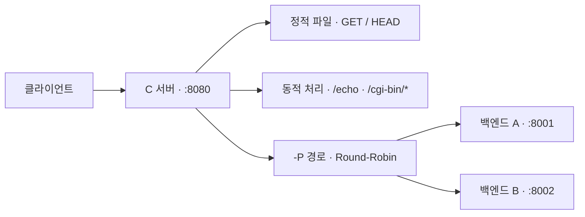

# tiny-web-server

**C와 POSIX 소켓으로 구현한 HTTP 서버.** 정적 파일, Echo, CGI는 C 서버에서 처리하고, `-P`로 지정한 경로(예: `/api`) 요청은 리버스 프록시가 백엔드들에 라운드로빈으로 전달합니다.

## 요청 처리 흐름



| 단계 | 핵심 동작 |
| --- | --- |
| TCP 연결 | `socket()` → `bind()` → `listen()` → `accept()` |
| HTTP 요청 | 헤더가 끝날 때까지 수신 데이터를 누적. POST 본문은 `Content-Length`만큼 읽기 |
| HTTP 응답 | 공통 응답 모듈에서 상태 라인과 `Content-Type`, `Content-Length`, `Connection`을 조립하고 본문 전송 |

<details>
<summary>처리기, 동시 연결, 종료 처리</summary>

- **정적 파일** · MIME 타입 매핑. `HEAD`는 헤더만 전송. 파일 없음 `404`, 접근 금지 `403`, 내부 오류 `500`.
- **동적 요청** · `POST /echo`는 본문을 그대로 응답. `/cgi-bin/*`는 CGI 실행 결과를 응답에 사용.
- **동시 연결** · `pthread` 워커가 요청을 처리. 다음 요청을 기다리는 Keep-Alive 연결은 별도 스레드에서 `poll()`로 감시.
- **종료** · `SIGINT`나 `SIGTERM`을 받으면 새 연결 수락을 멈추고 종료 시한 안에서 진행 중인 작업을 정리. `SIGPIPE`를 무시하고 쓰기 오류 처리.

</details>

## 설계 선택과 트레이드오프

| 선택 | 대안 | 얻은 점 | 감수한 비용 |
| --- | --- | --- | --- |
| [`poll()`과 스레드 풀](src/server.c) | 연결마다 스레드 생성, `epoll()` 이벤트 루프 | 워커 재사용, macOS·Linux 공통 API | 감시할 FD가 늘면 검사량 증가. 백엔드 응답 대기 중 워커 점유 |
| [경로 기반 라우팅, 가장 긴 prefix 우선](src/proxy.c) | `Host` 기반 라우팅 | 한 호스트에서 정적 파일과 여러 API 그룹 제공 | 호스트별로 서비스를 나눌 때는 별도 규칙 필요 |
| [Round-Robin](src/handler_proxy.c) (그룹마다 원자적 번호표) | 처리 중인 요청이 가장 적은 백엔드 선택 | 자물쇠 없이 등록 순서대로 분배 | 백엔드의 처리 속도나 현재 부하를 분배에 반영하지 않음 |
| [실패 시 다음 백엔드로 1번 재시도](src/proxy.c) | 재시도 없음, 주기적 헬스 체크 | 백엔드 하나가 죽어도 요청이 성공 | POST 는 보낸 뒤 끊기면 재시도하지 않음 (중복 실행 방지) |
| [응답 전체 검증 후 전송](src/handler_proxy.c) | 받은 바이트를 바로 보내는 스트리밍 | 본문이 잘리면 성공 응답을 내보내기 전에 오류 반환 | 첫 바이트 지연, 버퍼 메모리 사용. 본문 상한 8 MiB |

**백엔드 장애 예시** · `200 OK`를 보낸 백엔드가 본문 전송 중에 끊기면, 프록시가 잘린 응답을 감지해 클라이언트에 **`502 Bad Gateway`**를 반환합니다.

## 검증 결과

**프록시 검사 160개 이상 통과** · C 단위 테스트(`tests/test_proxy.c`), 셸 e2e(`tests/e2e.sh`), Python 통합 테스트(`tests/test_reverse_proxy.py`, 백엔드 두 대를 띄우고 실제 TCP 연결로 검증).

| 테스트 입력 | 확인한 결과 |
| --- | --- |
| API 요청 3건을 순서대로 전송 | 백엔드 **A → B → A** |
| 다른 그룹 요청이 사이에 끼어듦 | 그룹마다 순서 유지 (번호표가 그룹별) |
| 쿼리와 바이너리 본문을 담아 POST | 원래 쿼리와 본문을 그대로 전달 |
| 백엔드 하나가 꺼짐 | 다음 백엔드로 재시도해서 **`200`** |
| GET 중 백엔드가 끊김 / POST 중 끊김 | GET 은 재시도해서 `200`, POST 는 재시도 없이 **`502`** |
| 백엔드가 모두 꺼짐, 응답이 잘림, 응답 머리가 잘못됨 | **`502 Bad Gateway`** |
| 백엔드가 `-W` 초 안에 응답하지 않음 | **`504 Gateway Timeout`** |
| 백엔드가 `204` / `304` / `HEAD` 응답 | 본문 없이 전달, `204` 에는 `Content-Length` 없음 |
| 같은 클라이언트 TCP 연결에서 요청 2건 | **두 요청 모두 성공**, 연결 재사용 |

<details>
<summary>검증 명령과 범위</summary>

```sh
make all
make test          # 단위 테스트 (test_proxy 포함)
make asan          # AddressSanitizer/UBSan
make tsan          # ThreadSanitizer (데이터 경쟁 0)
make e2e           # curl 기능 테스트 (프록시 포함)
make test-proxy    # Python 통합 테스트 11개
ASAN_OPTIONS=detect_leaks=1 make test-proxy E2E_BIN=build/tiny-asan
```

- `make test`에서 분할 수신된 POST 본문 복원과 뒤따라온 요청의 경계 처리를 확인했습니다.
- 프록시 통합 테스트는 일반 빌드와 sanitizer 빌드에서 각각 11개를 통과했습니다.
- 클라우드(root) 환경에서는 e2e 중 환경 탓인 4개(권한 403, curl 문구, CGI 타이밍, ps 확인)가 실패합니다.

</details>

<details>
<summary>실행 방법과 프록시 제약</summary>

백엔드를 먼저 실행합니다. `make`로 서버와 CGI 예제를 빌드한 뒤, `-P 경로=호스트:포트,...`로 프록시 그룹을 지정합니다.

```sh
make
./build/tiny -p 8080 -r ./www -P /api=127.0.0.1:8001,127.0.0.1:8002
# 그룹 여러 개 (가장 긴 prefix 우선), 응답 대기 3초
./build/tiny -p 8080 -P /api=127.0.0.1:8001,127.0.0.1:8002 -P /api/admin=127.0.0.1:9000 -W 3
```

- 경로는 바꾸지 않고 그대로 전달합니다. `/api`는 `/api`, `/api/...`에만 맞고 `/apix`에는 맞지 않습니다. 어느 그룹에도 안 맞으면 정적 파일/CGI로 처리합니다.
- 그룹은 최대 8개, 그룹당 백엔드는 최대 8개입니다. 서버 자신을 백엔드로 지정하면 시작을 거부합니다.
- 백엔드 연결은 요청마다 열고 닫습니다 (HTTP/1.0 + `Connection: close`, `X-Forwarded-For` 추가). 연결 제한 2초, 응답 제한 기본 10초(`-W`).
- 응답은 머리 8KB, 본문 8MB까지 모아서 보냅니다. 본문 끝은 `Content-Length` 또는 백엔드 연결 종료로 판단합니다. `Transfer-Encoding: chunked`와 `1xx` 응답에는 `502`를 반환합니다.

</details>

## 마무리

> **기술 선택의 답은 상황마다 달라집니다.** 이번에는 정확한 오류 응답을 위해 전송 전에 본문을 검증했습니다. 대용량 응답을 일찍 보내는 게 더 중요하다면 스트리밍이 맞을 수 있습니다. 무엇을 우선하고 어떤 비용을 감수할 수 있는지가 선택의 기준입니다.
